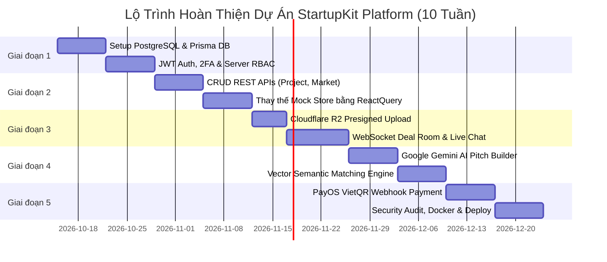

# TÀI LIỆU PHÂN TÍCH HỆ THỐNG & LỘ TRÌNH HOÀN THIỆN DỰ ÁN STARTUPKIT PLATFORM
> **Phiên bản:** 1.0.0 — Production Blueprint  
> **Nền tảng:** StartupKit — Hệ sinh thái Khởi nghiệp Đổi mới Sáng tạo & Kết nối Đầu tư Việt Nam  
> **Ngày cập nhật:** Tháng 10/2026  

---

## MỤC LỤC
1. [Tổng Quan Dự Án & Đánh Giá Hiện Trạng](#1-tổng-quan-dự-án--đánh-giá-hiện-trạng)
2. [Ma Trận Lỗ Hổng & Điểm Nghẽn (Gap Analysis Matrix)](#2-ma-trận-lỗ-hổng--điểm-nghẽn-gap-analysis-matrix)
3. [Kiến Trúc Kỹ Thuật Đích (Target Production Architecture)](#3-kiến-trúc-kỹ-thuật-đích-target-production-architecture)
4. [Mô Hình Dữ Liệu Chi Tiết (Database Schema & DDL / Prisma)](#4-mô-hình-dữ-liệu-chi-tiết-database-schema--ddl--prisma)
5. [Đặc Tả Hệ Thống API RESTful & WebSocket](#5-đặc-tả-hệ-thống-api-restful--websocket)
6. [Thiết Kế Động Cơ AI (AI Pitch Builder & Matching Engine)](#6-thiết-kế-động-cơ-ai-ai-pitch-builder--matching-engine)
7. [Tích Hợp Thanh Toán & Billing System (PayOS / VNPay)](#7-tích-hợp-thanh-toán--billing-system-payos--vnpay)
8. [Lộ Trình Triển Khai Thực Thi 5 Giai Đoạn (Execution Roadmap)](#8-lộ-trình-triển-khai-thực-thi-5-giai-đoạn-execution-roadmap)

---

## 1. TỔNG QUAN DỰ ÁN & ĐÁNH GIÁ HIỆN TRẠNG

### 1.1 Mục Tiêu & Định Vị Nền Tảng
**StartupKit** là nền tảng số hóa hệ sinh thái khởi nghiệp sáng tạo toàn diện (Startup Ecosystem Marketplace) tại Việt Nam, kết nối 4 nhóm đối tượng then chốt:
- **Nhà sáng lập (Startups / Founders):** Tạo hồ sơ dự án theo chuẩn VC, sử dụng AI Pitch Builder tự động trích xuất và chuẩn hóa pitch deck, đánh giá độ sẵn sàng gọi vốn (AI Credibility Score) và tiếp cận quỹ đầu tư/cố vấn.
- **Nhà đầu tư (Investors / VCs / Angels):** Lọc deal thông minh theo khẩu vị đầu tư, thẩm định danh mục, tương tác trực tiếp trong Deal Room ảo bảo mật với NDA tự động.
- **Cố vấn chuyên môn (Mentors / Experts):** Đặt lịch tư vấn (Mentorship sessions), đánh giá dự án và tạo mạng lưới bảo chứng tín nhiệm cho startup.
- **Quản trị viên (Admin & Ecosystem Operators):** Kiểm duyệt dự án, xác minh danh tính (KYC/KYB), quản trị thanh toán, phân tích dòng vốn và báo cáo hệ sinh thái.

### 1.2 Đánh Giá Hiện Trạng Frontend Codebase
- **Công nghệ cốt lõi:** Next.js 16.1.6 (App Router), React 19, TypeScript, Tailwind CSS v4, shadcn/ui.
- **Giao diện & Trải nghiệm:** Phong cách 3D Isometric Spatial Minimal hiện đại, bảng màu chuẩn Đen (`#111111`) – Vàng Gold (`#F4B400`) – Trắng/Xám viền (`#EAEAEA`).
- **Hệ thống đa ngôn ngữ (i18n):** Cấu trúc URL `/[locale]` (Tiếng Việt `vi` mặc định, Tiếng Anh `en`), middleware định tuyến `proxy.ts`, tải từ điển `dictionaries/`.
- **Độ phủ trang giao diện:** Đã xây dựng hoàn chỉnh **109 routes** (Landing page, Marketplace, Deal Room, 4 Workspace riêng biệt theo role, Hồ sơ, Cài đặt, Auth).

---

## 2. MA TRẬN LỖ HỔNG & ĐIỂM NGHẼN (GAP ANALYSIS MATRIX)

Dù giao diện UI/UX và logic tương tác phía client đã hoàn thiện xuất sắc, dự án hiện đang hoạt động ở dạng **Frontend Prototype với Mock Data**. Để đưa vào vận hành thương mại (Production Ready), cần bù đắp các lỗ hổng cốt lõi sau:

| Thành Phần | Hiện Trạng (AS-IS) | Yêu Cầu Đích (TO-BE Production) | Mức Độ Cần Thiết |
|---|---|---|:---:|
| **Cơ Sở Dữ Liệu (Database)** | 100% Mock Data trong `localStorage` (`lib/*-store.ts`) | Cơ sở dữ liệu quan hệ **PostgreSQL** kết hợp **Prisma ORM** / Drizzle ORM | **BẮT BUỘC (P0)** |
| **Xác Thực & Phân Quyền (Auth & RBAC)** | Giả lập qua cookie `startupkit_role` & `auth-context.tsx` | Hệ thống Auth chuẩn **JWT / HTTP-only Session Cookie**, mã hóa Bcrypt/Argon2, OAuth2 (Google/LinkedIn), 2FA TOTP | **BẮT BUỘC (P0)** |
| **API Backend** | Chưa có API server, không có fetch/axios/React Query | Hệ thống **RESTful API / Next.js Route Handlers** kết hợp **TanStack Query (React Query)** | **BẮT BUỘC (P0)** |
| **Lưu Trữ Tệp (File Storage)** | Chưa có, deck và avatar dùng mock URL tĩnh | Object Storage trên **Cloudflare R2** hoặc **AWS S3** với Presigned URL bảo mật | **BẮT BUỘC (P0)** |
| **Realtime Communication** | Chat widget và tin nhắn Deal Room lưu localStorage | **WebSocket / Socket.io** hoặc **Pusher / Supabase Realtime** cho tin nhắn tức thời và thông báo đẩy | **CAO (P1)** |
| **Động Cơ AI (AI Services)** | Mô phỏng qua dữ liệu JSON tĩnh | Tích hợp **Google Gemini 2.0 / 1.5 Flash API** để parse PDF Pitch Deck, chấm điểm tín nhiệm và Semantic Vector Search | **CAO (P1)** |
| **Cổng Thanh Toán (Billing)** | Chỉ có tài liệu đặc tả, chưa có code xử lý giao dịch | Tích hợp **PayOS / VNPay SDK** với Webhook xác thực chữ ký số, quản lý gói hội viên và phí thành công Deal (10%) | **CAO (P1)** |

---

## 3. KIẾN TRÚC KỸ THUẬT ĐÍCH (TARGET PRODUCTION ARCHITECTURE)

```
┌──────────────────────────────────────────────────────────────────────────────────┐
│                                 CLIENT LAYER                                     │
│  Next.js 16 App Router (React 19) • Tailwind v4 • shadcn/ui • TanStack Query     │
│  [Founder Workspace]  [Investor Workspace]  [Mentor Workspace]  [Admin Panel]    │
└────────────────────────────────────────┬─────────────────────────────────────────┘
                                         │ HTTPS / WSS
┌────────────────────────────────────────▼─────────────────────────────────────────┐
│                           API GATEWAY / MIDDLEWARE                               │
│  Edge Proxy (proxy.ts) • JWT & RBAC Guard • Rate Limiting • i18n Detection       │
└────────────────────────────────────────┬─────────────────────────────────────────┘
                                         │
        ┌────────────────────────────────┼────────────────────────────────┐
        ▼                                ▼                                ▼
┌──────────────────────┐  ┌──────────────────────────────┐  ┌──────────────────────┐
│  CORE BUSINESS APIS  │  │   REALTIME & DEAL ROOM       │  │  AI PROCESSING ENGINE│
│  - User & Profile    │  │   - WebSocket Server         │  │  - Deck PDF Parser   │
│  - Project CRUD      │  │   - Live Deal Room Chat      │  │  - Pitch Memo Synth  │
│  - Deal Management   │  │   - Status Event Stream      │  │  - Semantic Matcher  │
│  - Mentorship Engine │  │   - Push Notifications       │  │  - Credibility Score │
└──────────┬───────────┘  └──────────────┬───────────────┘  └──────────┬───────────┘
           │                             │                             │
           └─────────────────────────────┼─────────────────────────────┘
                                         │
┌────────────────────────────────────────▼─────────────────────────────────────────┐
│                               DATA & STORAGE LAYER                               │
│  - PostgreSQL: Bảng quan hệ dữ liệu cốt lõi (Prisma ORM)                         │
│  - Redis: Cache tầng dữ liệu, Session Store, Rate-limit counters, Pub/Sub socket │
│  - Cloudflare R2 / AWS S3: Lưu trữ tài liệu thẩm định, Pitch Deck PDF, Avatar     │
│  - PayOS / VNPay Gateway: Xử lý thanh toán QR chuyển khoản ngân hàng Việt Nam   │
└──────────────────────────────────────────────────────────────────────────────────┘
```

---

## 4. MÔ HÌNH DỮ LIỆU CHI TIẾT (DATABASE SCHEMA & PRISMA)

Dưới đây là lược đồ cơ sở dữ liệu hoàn chỉnh chuẩn hóa cho PostgreSQL sử dụng Prisma:

```prisma
datasource db {
  provider = "postgresql"
  url      = env("DATABASE_URL")
}

generator client {
  provider = "prisma-client-js"
}

enum Role {
  GUEST
  STARTUP
  INVESTOR
  MENTOR
  ADMIN
}

enum ProjectStage {
  IDEA
  PRE_SEED
  SEED
  SERIES_A
  SERIES_B_PLUS
}

enum ProjectStatus {
  DRAFT
  PENDING_REVIEW
  PUBLISHED
  FEATURED
  ARCHIVED
}

enum DealStatus {
  INQUIRY
  NDA_PENDING
  NDA_SIGNED
  DUE_DILIGENCE
  TERM_SHEET
  COMMITTED
  COMPLETED
  REJECTED
}

// 1. TÀI KHOẢN & NGƯỜI DÙNG
model User {
  id            String         @id @default(uuid())
  email         String         @unique
  passwordHash  String
  fullName      String
  phoneNumber   String?
  avatarUrl     String?
  role          Role           @default(GUEST)
  isVerified    Boolean        @default(false)
  twoFactorEnabled Boolean     @default(false)
  twoFactorSecret  String?
  locale        String         @default("vi")
  createdAt     DateTime       @default(now())
  updatedAt     DateTime       @updatedAt

  founderProfile  FounderProfile?
  investorProfile InvestorProfile?
  mentorProfile   MentorProfile?
  notifications   Notification[]
  sentMessages    Message[]      @relation("SentMessages")
  dealMemberships DealRoomMember[]
  subscriptions   Subscription[]
}

// 2. HỒ SƠ STARTUP / FOUNDER
model FounderProfile {
  id              String      @id @default(uuid())
  userId          String      @unique
  user            User        @relation(fields: [userId], references: [id], onDelete: Cascade)
  companyName     String
  tagline         String?
  bio             String?
  website         String?
  linkedinUrl     String?
  country         String      @default("Vietnam")
  city            String      @default("Hanoi")
  projects        Project[]
  createdAt       DateTime    @default(now())
  updatedAt       DateTime    @updatedAt
}

// 3. DỰ ÁN KHỞI NGHIỆP
model Project {
  id              String         @id @default(uuid())
  founderId       String
  founder         FounderProfile @relation(fields: [founderId], references: [id], onDelete: Cascade)
  title           String
  slug            String         @unique
  tagline         String
  description     String
  category        String         // FinTech, AI, SaaS, AgriTech, etc.
  stage           ProjectStage   @default(SEED)
  status          ProjectStatus  @default(DRAFT)
  
  // Tài chính & Gọi vốn
  targetRaiseUsd  Decimal        @db.Decimal(12, 2)
  raisedSoFarUsd  Decimal        @default(0) @db.Decimal(12, 2)
  valuationUsd    Decimal?       @db.Decimal(12, 2)
  minTicketUsd    Decimal?       @db.Decimal(12, 2)
  
  // Chỉ số & Thẩm định AI
  credibilityScore Int           @default(70) // 0-100
  aiReadinessScore Int           @default(75) // 0-100
  aiEvaluationSummary Json?      // Phân tích SWOT, Unit Economics, Moat
  
  // Media & Documents
  coverImageUrl   String?
  pitchDeckPdfUrl String?
  businessPlanUrl String?
  demoUrl         String?
  
  deals           Deal[]
  createdAt       DateTime       @default(now())
  updatedAt       DateTime       @updatedAt
}

// 4. HỒ SƠ NHÀ ĐẦU TƯ
model InvestorProfile {
  id              String      @id @default(uuid())
  userId          String      @unique
  user            User        @relation(fields: [userId], references: [id], onDelete: Cascade)
  organization    String      // Tên quỹ hoặc "Angel Investor"
  investorType    String      // VC, Angel Network, Corporate VC, Family Office
  ticketMinUsd    Decimal     @db.Decimal(12, 2)
  ticketMaxUsd    Decimal     @db.Decimal(12, 2)
  targetStages    ProjectStage[]
  targetSectors   String[]
  aumUsd          Decimal?    @db.Decimal(14, 2) // Assets under management
  deals           Deal[]
  createdAt       DateTime    @default(now())
  updatedAt       DateTime    @updatedAt
}

// 5. HỒ SƠ CỐ VẤN
model MentorProfile {
  id              String      @id @default(uuid())
  userId          String      @unique
  user            User        @relation(fields: [userId], references: [id], onDelete: Cascade)
  title           String      // Ex: Ex-VP of Engineering, Serial Founder
  currentCompany  String?
  expertiseAreas  String[]
  hourlyRateUsd   Decimal     @default(0) @db.Decimal(8, 2)
  totalSessions   Int         @default(0)
  averageRating   Decimal     @default(5.0) @db.Decimal(3, 2)
  sessions        MentorSession[]
  createdAt       DateTime    @default(now())
  updatedAt       DateTime    @updatedAt
}

// 6. DEAL ROOM & GIAO DỊCH ĐẦU TƯ
model Deal {
  id              String         @id @default(uuid())
  projectId       String
  project         Project        @relation(fields: [projectId], references: [id])
  investorId      String
  investor        InvestorProfile @relation(fields: [investorId], references: [id])
  status          DealStatus     @default(INQUIRY)
  proposedAmount  Decimal?       @db.Decimal(12, 2)
  agreedValuation Decimal?       @db.Decimal(12, 2)
  successFeePercent Decimal      @default(10.0) @db.Decimal(4, 2) // 10%
  dealRoom        DealRoom?
  createdAt       DateTime       @default(now())
  updatedAt       DateTime       @updatedAt
}

model DealRoom {
  id              String           @id @default(uuid())
  dealId          String           @unique
  deal            Deal             @relation(fields: [dealId], references: [id], onDelete: Cascade)
  roomName        String
  ndaContent      String?
  isNdaSigned     Boolean          @default(false)
  members         DealRoomMember[]
  messages        Message[]
  documents       DealDocument[]
  createdAt       DateTime         @default(now())
  updatedAt       DateTime         @updatedAt
}

model DealRoomMember {
  id              String      @id @default(uuid())
  dealRoomId      String
  dealRoom        DealRoom    @relation(fields: [dealRoomId], references: [id], onDelete: Cascade)
  userId          String
  user            User        @relation(fields: [userId], references: [id])
  roleInRoom      String      // FOUNDER, INVESTOR, LEGAL_COUNSEL
  hasSignedNda    Boolean     @default(false)
  signedAt        DateTime?
}

model DealDocument {
  id              String      @id @default(uuid())
  dealRoomId      String
  dealRoom        DealRoom    @relation(fields: [dealRoomId], references: [id], onDelete: Cascade)
  fileName        String
  fileUrl         String
  fileType        String      // FINANCIAL_MODEL, CAP_TABLE, LEGAL_AUDIT
  uploadedBy      String
  createdAt       DateTime    @default(now())
}

model Message {
  id              String      @id @default(uuid())
  dealRoomId      String?
  dealRoom        DealRoom?   @relation(fields: [dealRoomId], references: [id], onDelete: Cascade)
  senderId        String
  sender          User        @relation("SentMessages", fields: [senderId], references: [id])
  content         String
  attachmentUrl   String?
  createdAt       DateTime    @default(now())
}

// 7. PHIÊN CỐ VẤN
model MentorSession {
  id              String         @id @default(uuid())
  mentorId        String
  mentor          MentorProfile  @relation(fields: [mentorId], references: [id])
  founderUserId   String
  scheduledAt     DateTime
  durationMinutes Int            @default(60)
  status          String         // SCHEDULED, COMPLETED, CANCELLED
  meetingUrl      String?
  feedbackNote    String?
  rating          Int?           // 1-5
  createdAt       DateTime       @default(now())
}

// 8. ĐĂNG KÝ GÓI & THANH TOÁN
model Subscription {
  id              String      @id @default(uuid())
  userId          String
  user            User        @relation(fields: [userId], references: [id])
  planTier        String      // FREE, PRO_FOUNDER, VC_ENTERPRISE
  status          String      // ACTIVE, EXPIRED, CANCELLED
  startDate       DateTime    @default(now())
  endDate         DateTime
  amountVnd       Decimal     @db.Decimal(12, 0)
  transactions    Transaction[]
}

model Transaction {
  id              String        @id @default(uuid())
  subscriptionId  String?
  subscription    Subscription? @relation(fields: [subscriptionId], references: [id])
  orderCode       Int           @unique
  amountVnd       Decimal       @db.Decimal(12, 0)
  provider        String        // PAYOS, VNPAY
  transactionRef  String?
  status          String        // PENDING, SUCCESS, FAILED
  paymentUrl      String?
  createdAt       DateTime      @default(now())
  completedAt     DateTime?
}

model Notification {
  id              String      @id @default(uuid())
  userId          String
  user            User        @relation(fields: [userId], references: [id], onDelete: Cascade)
  title           String
  message         String
  link            String?
  isRead          Boolean     @default(false)
  createdAt       DateTime    @default(now())
}
```

---

## 5. ĐẶC TẢ HỆ THỐNG API RESTFUL & WEBSOCKET

### 5.1 Nhóm Xác Thực & Phân Quyền (`/api/auth/*`)
- `POST /api/auth/register`: Đăng ký tài khoản mới theo vai trò (STARTUP, INVESTOR, MENTOR).
- `POST /api/auth/login`: Xác thực Email/Password, cấp Access Token (JWT 15m) + Refresh Token (HTTP-Only Cookie 7d).
- `POST /api/auth/refresh`: Làm mới phiên đăng nhập không gián đoạn.
- `POST /api/auth/logout`: Thu hồi Refresh Token và xóa cookie.
- `POST /api/auth/2fa/verify`: Xác thực mã OTP 6 số từ Google Authenticator cho tài khoản Investor/Admin.

### 5.2 Nhóm Marketplace & Dự Án (`/api/market/*` & `/api/projects/*`)
- `GET /api/market/startups`: Lọc danh sách dự án với phân trang, lọc theo ngành (Category), giai đoạn (Stage), khoảng vốn gọi (Raise range), sắp xếp theo AI Score.
- `GET /api/market/investors`: Danh sách quỹ đầu tư và thiên thần với thông tin khẩu vị và Ticket Size.
- `GET /api/market/mentors`: Danh sách chuyên gia theo lĩnh vực (Product, Growth, Tech, Legal).
- `POST /api/projects`: Tạo dự án mới (bắt buộc role `STARTUP`).
- `PUT /api/projects/:id`: Cập nhật thông tin dự án, metrics tài chính, tài liệu.
- `POST /api/projects/:id/upload-deck`: Nhận Presigned URL tải lên file PDF Pitch Deck lên Cloudflare R2 / AWS S3.

### 5.3 Nhóm Deal Room Ảo (`/api/deals/*`)
- `POST /api/deals/request`: Nhà đầu tư gửi yêu cầu kết nối Deal với Startup.
- `POST /api/deals/:id/accept`: Startup chấp thuận mở Deal Room.
- `POST /api/deals/:id/sign-nda`: Ký điện tử thỏa thuận bảo mật NDA.
- `GET /api/deals/:id/room`: Lấy toàn bộ tài liệu mật, cap table, luồng chat của Deal Room.

### 5.4 Nhóm Realtime WebSocket (`/ws/deal-room/*`)
- `deal_room:join`: Tham gia phòng đàm phán trực tiếp.
- `deal_room:message`: Gửi tin nhắn tức thì, cập nhật trạng thái đã xem.
- `deal_room:doc_uploaded`: Thông báo tức thời khi có báo cáo tài chính/tài liệu thẩm định mới được cập nhật.

---

## 6. THIẾT KẾ ĐỘNG CƠ AI (AI PITCH BUILDER & MATCHING ENGINE)

### 6.1 AI Pitch Builder Pipeline (Tích hợp Google Gemini API)
```
  [Pitch Deck PDF / Form Raw Text]
                 │
                 ▼
     [1. PDF Parser & OCR Module]
                 │
                 ▼
  [2. Google Gemini 2.0 Flash Extraction]
     - Trích xuất 24 tham số cốt lõi:
       + Problem Statement & Target Market Size (TAM/SAM/SOM)
       + Value Proposition & Product Architecture
       + Business Model & Unit Economics (LTV/CAC, Payback Period)
       + Traction Metrics (MRR, MoM Growth, Active Users, Churn)
       + Competitor Landscape & Defensible Moat
       + Team Credentials & Cap Table Structure
                 │
                 ▼
  [3. Quantitative Scoring Algorithm]
     - Đối soát với dữ liệu chuẩn 500+ vòng gọi vốn thành công
     - Sinh ra: AI Credibility Score (0-100) & AI Readiness Score (0-100)
                 │
                 ▼
  [4. Standardized VC Memo Synthesis]
     - Tự động sinh Executive Summary 1 trang chuẩn định dạng Sequoia / Y Combinator.
```

### 6.2 Thuật Toán Matching Hai Chiều (Startup ↔ Investor ↔ Mentor)
Kết hợp 2 tầng lọc:
1. **Tầng lọc cứng (Hard Filters - Boolean Constraints):**
   - Lĩnh vực (Industry Sector): Ví dụ: Quỹ chỉ đầu tư B2B SaaS.
   - Giai đoạn (Stage): Seed / Pre-A.
   - Ticket Size: Quy mô vốn gọi nằm trong khoảng `[ticketMin, ticketMax]`.
   - Vị trí địa lý (Geography): Trọng tâm Việt Nam / Đông Nam Á.
2. **Tầng lọc ngữ nghĩa (Soft Semantic Scoring):**
   - Tạo vector embedding cho Profile Startup và Investment Mandate của Investor bằng model `text-embedding-004`.
   - Tính Cosine Similarity giữa hai vector:
   $$\text{MatchScore} = 0.5 \times \text{CosineSim} + 0.3 \times \text{CredibilityScore} + 0.2 \times \text{StageAlignment}$$

---

## 7. TÍCH HỢP THANH TOÁN & BILLING SYSTEM (PayOS / VNPAY)

Theo tài liệu chi tiết tại `docs/BILLING_SYSTEM.md`:

### 7.1 Mô Hình Doanh Thu Kép
1. **Gói Hội Viên Định Kỳ (Subscription Plans):**
   - **Gói Miễn Phí (Starter):** 0 VNĐ — Tạo 1 dự án, hồ sơ công khai, nhận deal inbound.
   - **Gói Founder Pro:** 499.000 VNĐ / tháng — Không giới hạn dự án, sử dụng AI Pitch Builder không giới hạn, xem chi tiết danh bạ 80+ Quỹ đầu tư, mở Deal Room bảo mật.
   - **Gói Investor / Mentor VIP:** 999.000 VNĐ / tháng — Báo cáo phân tích chuyên sâu, ưu tiên duyệt deal, công cụ chấm điểm AI độc quyền.
2. **Phí Thành Công Khi Đóng Deal (Success Fee):**
   - Nền tảng thu **10% Success Fee** trên giá trị vòng gọi vốn khi deal được chốt thành công thông qua Deal Room của StartupKit.

### 7.2 Luồng Thanh Toán PayOS (VietQR)
1. Người dùng bấm nâng cấp gói hoặc thanh toán phí.
2. Backend gọi `payOS.createPaymentLink({ orderCode, amount, description, returnUrl, cancelUrl })`.
3. Client hiển thị mã VietQR chuyển khoản ngân hàng chuẩn Napas247.
4. Người dùng quét mã trên ứng dụng ngân hàng và chuyển khoản.
5. Cổng PayOS bắn Webhook bảo mật về `POST /api/billing/webhook/payos`.
6. Backend xác thực chữ ký số HMAC-SHA256, chuyển trạng thái Transaction thành `SUCCESS`, tự động mở quyền truy cập cho User ngay lập tức.

---

## 8. LỘ TRÌNH TRIỂN KHAI THỰC THI 5 GIAI ĐOẠN (EXECUTION ROADMAP)



### Chi Tiết Từng Sprint:
- **Sprint 1 (Tuần 1 - 2): Hạ tầng Dữ liệu & Xác thực**
  - Khởi tạo cơ sở dữ liệu PostgreSQL (trên Neon/Supabase/RDS).
  - Viết migrations và Prisma client schema.
  - Xây dựng cụm API `/api/auth/*` với mã hóa mật khẩu, JWT cookie, 2FA.
- **Sprint 2 (Tuần 3 - 4): API Nghiệp vụ & Di chuyển Frontend**
  - Xây dựng API quản lý Startup, Investor, Mentor, Marketplace.
  - Cài đặt `@tanstack/react-query` vào Frontend, thay thế từng store mock trong `lib/*-store.ts`.
- **Sprint 3 (Tuần 5 - 6): Tài liệu Thẩm định & Deal Room Realtime**
  - Cấu hình Cloudflare R2 / S3 Presigned URL cho upload file Pitch Deck PDF và Avatar.
  - Triển khai Socket.io / Pusher cho tin nhắn tức thời và thông báo Deal Room.
- **Sprint 4 (Tuần 7 - 8): Tích hợp Trí tuệ Nhân tạo (AI Engine)**
  - Tích hợp Google Gemini SDK (`@google/genai`) xử lý trích xuất Pitch Deck.
  - Thuật toán chấm điểm tín nhiệm AI và Matching tự động.
- **Sprint 5 (Tuần 9 - 10): Thanh toán & Triển khai Sản xuất**
  - Tích hợp cổng thanh toán PayOS / VNPay, xử lý Webhook Idempotency.
  - Tối ưu hóa SEO, Lighthouse Audit (Điểm CWV 95+), đóng gói Docker container và deploy lên môi trường Production.

---
*Tài liệu được soạn thảo tự động và bảo chứng bởi Đội ngũ Kiến trúc Hệ thống StartupKit.*
